# Lab 4: Create a Custom AI Agent Using the Exadata Database Service MCP Server

## Introduction

**Create a Custom AI Agent Using The Managed MCP Servers for Exadata Database Service** shows how to build a custom AI agent in Oracle AI Database Private Agent Factory that uses both data plane and control plane MCP servers.

In this lab, you will explore **Oracle AI Database Private Agent Factory**, a no-code environment for building, deploying, and managing AI agents grounded in enterprise data.

Using Agent Builder, you will create a custom AI agent for Exadata Database Service that combines AI models, agent workflows, and two MCP servers:

- **Data plane:** The Database Tools MCP Server gives the agent access to configured database tools, such as SQL queries and approved SQL Reports, to answer questions about database data.
- **Control plane:** Managed MCP Servers for OCI Database Services give the agent access to supported OCI control-plane tools for Exadata infrastructure, VM clusters, databases, and related operational information.

Together, these MCP tools let the agent use enterprise data and Exadata resource context to answer questions across both areas, including health-check questions about the database and its infrastructure. Access to data and database operations remains governed by the configured tools and permissions.

**Estimated Time:** 10 minutes

### Objectives

In this lab, you will:

- Create a custom AI agent using Agent Builder in Private Agent Factory.
- Connect the agent to the Database Tools MCP Server to access configured database tools.
- Connect the agent to the Managed MCP Server for OCI Database Services to access supported Exadata control-plane tools.
- Test natural-language questions that combine database results with Exadata infrastructure and database information.

### Prerequisites

Before starting this lab, verify that the following resources are available:

- Access to the Oracle AI Database Private Agent Factory workshop environment.
- The workshop user credentials provided to you.
- Access to the language model configured for the workshop.
- Access to the preconfigured MCP Server for Exadata Database Service and its sample retail sales dataset.

> **Note:** The database, AI models, network access, IAM configuration, and supporting resources required for this workshop are provided as part of the workshop environment unless otherwise specified.

You will use **Agent Builder** to create a custom AI agent that interacts with Oracle AI Database through the managed MCP Server preconfigured for this workshop.

Model Context Protocol provides a standardized interface through which an AI agent can discover and invoke approved tools. In this workshop, the MCP Server provides the governed connection between Private Agent Factory and Oracle AI Database.

The resulting flow is:

```text
User
  |
  v
Oracle AI Database Private Agent Factory
  |
  v
Custom AI Agent
  |
  v
MCP Tool
  |
  v
Exadata Database Service MCP Server
  |
  v
Oracle AI Database
```

## Task 1: Review the Preconfigured MCP Server

In this task, you will locate and review the MCP Server that has already been configured in Oracle AI Database Private Agent Factory.

1. In the left navigation menu, scroll to **Utilities**.

2. Select **MCP Servers**.

3. Locate the preconfigured MCP Server named: ***MCP Server for Exadata Database Service***

4. Confirm that the MCP Server status is **Connected**.

    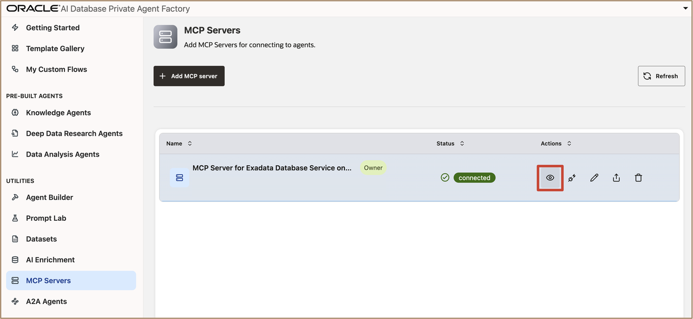

    > **Important:** The MCP Server has already been configured for you. Do not click **Add MCP server**, modify the configuration, enter credentials, or delete the existing MCP Server.

5. In the **Actions** column, click the **View** icon.

6. Review the MCP Server details displayed in the dialog, including:

    - MCP Server name
    - Resource access
    - Sharing information
    - Ownership

    You have now located and reviewed the preconfigured MCP Server in Private Agent Factory.

## Task 2: Create a Custom Agent Flow

1. Navigate to **Agent Builder**.

    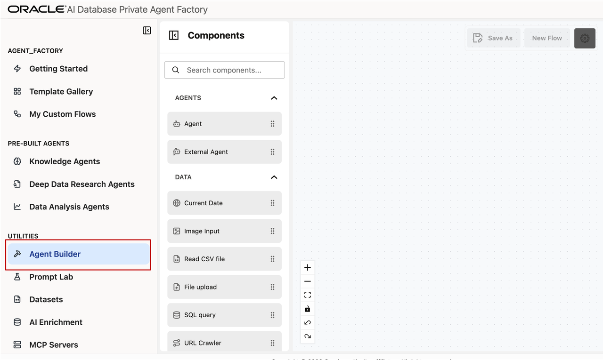

2. On the Agent Builder canvas, add the components required for the custom agent workflow.

    Add the **Agent** component

    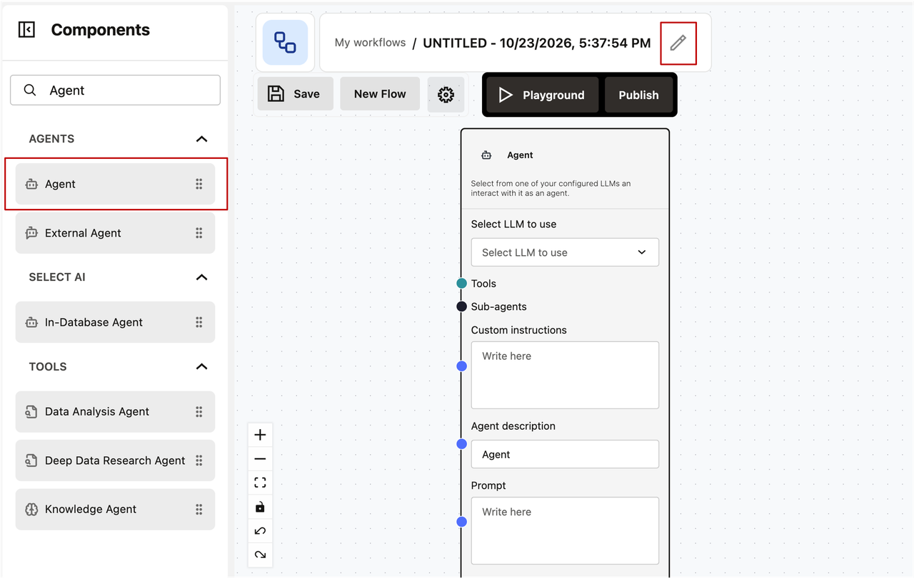

3. Click the **Edit** pencil beside the flow name and enter a name for the flow.

    For example:

    ```text
    <copy>Retail Data Insights Agent</copy>
    ```

    Enter a description.

    For example:

    ```text
    <copy>An MCP-powered retail data agent connected to the Database Tools MCP Server. It uses configured Oracle Database tools and reports to answer natural-language questions about the retail dataset.</copy>
    ```


4. Click **Save changes** to create the flow.

## Task 3: Configure the Agent

1. Select the **Agent** component on the canvas.

2. Under **Select LLM to use**, select the LLM provided for the workshop environment:

    Select `AIW26-PAF-HOL6004..`, as shown in the screenshot, or the model specified by your instructor.

3. In **Custom instructions**, enter the following:

    ```nohighlight
    <copy>You are the Retail Data Insights Agent, an enterprise assistant for the Northstar retail dataset in Oracle Database.

    Use the connected MCP tools whenever a question needs data, schema details or calculations. Prefer the built-in AGENT_* functions, called as SELECT AGENT_X(...) FROM dual, because they apply the business rules. Look up their parameters in USER_ARGUMENTS.

    Base answers on tool results. Do not invent records, values, table or column names, or query results. If a query fails or results are incomplete, say so and ask one focused follow-up question.

    The data is frozen at the latest inventory snapshot (2026-10-16 06:00). Treat that as "now" and say "as of the snapshot".

    This environment is read-only. Never call AGENT_RECORD_RECOMMENDATION, AGENT_DRAFT_REPLENISHMENT_ORDER or AGENT_PLACE_PRODUCT_HOLD, because they write data even inside a SELECT. Never run INSERT, UPDATE, DELETE, DDL or COMMIT. Do not expose credentials or secrets.

    Answer concisely with short bullets or a table. For policy answers, cite rules as [1], [2] and end with a Sources list giving the reference code, document name and section.</copy>
    ```

4. In **Agent description**, enter the name of the agent:

    ```nohighlight
    <copy>Answers questions about North Superstore retail stores, products, inventory, sales, promotions, supplier orders and company policies, using read-only access to Oracle Database through MCP.</copy>
    ```

5. Leave the **Prompt** field blank.

6. Leave **Temperature** at the workshop default of `0.01`.

7. Review the Agent configuration

    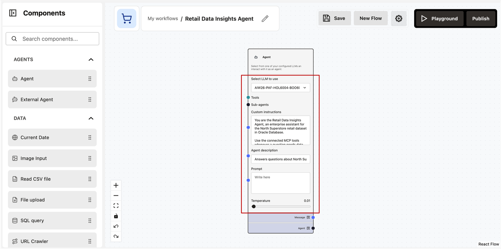

## Task 4: Add the MCP Tools

1. Add an **MCP Server** component to the workflow. Select the MCP Server connection configured earlier.

    Review the tools available from the MCP Server.

    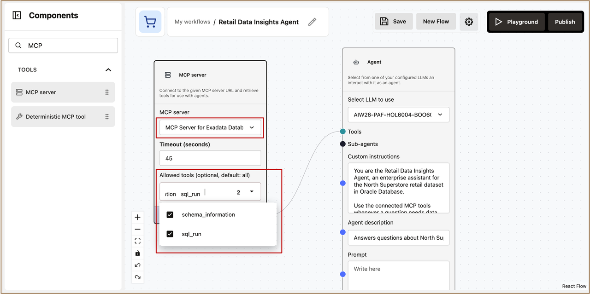

    In **Allowed tools**, select the tools approved by your instructor for schema and object discovery and read-only queries. For this lab, choose ***schema\_information*** and ***sql\_run***

    > **Note:** Limiting an agent to the tools required for its intended task reduces unnecessary capabilities and helps maintain a governed agent workflow.

2. Connect the MCP Server component to the **Tools** input of the Agent component.

    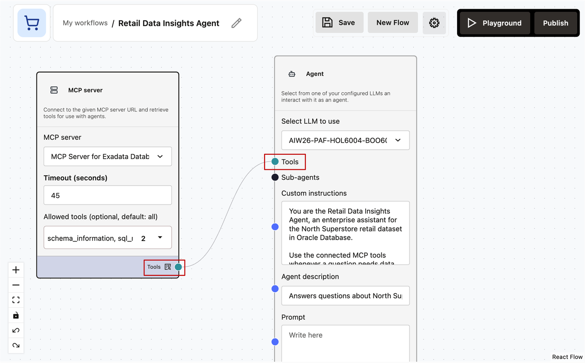

3. Add and connect the remaining workflow components.

    Add the Chat Input and Chat Output components.

    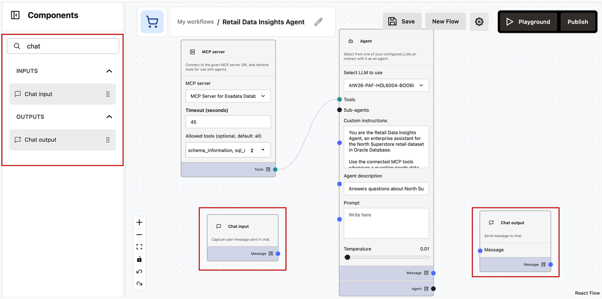

    Connect the **Message** output of **Chat input** to the Agent's **Prompt** input. Connect the Agent's **Message** output to the **Message** input of **Chat output**.

    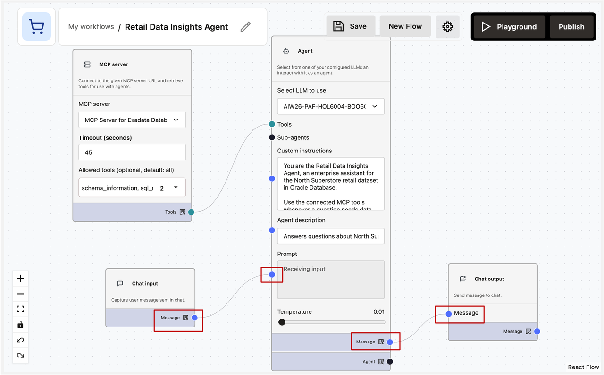

4. Click **Save** to save the custom agent flow.

    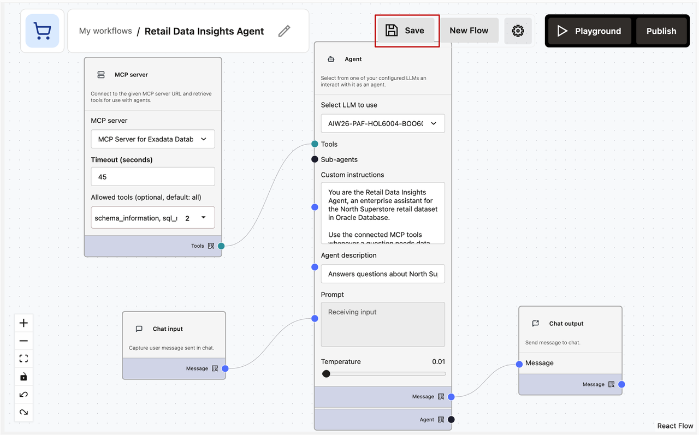

## Task 5: Ask the agent questions in Playground

1. Select **Playground** in the upper-right corner of the flow editor.

    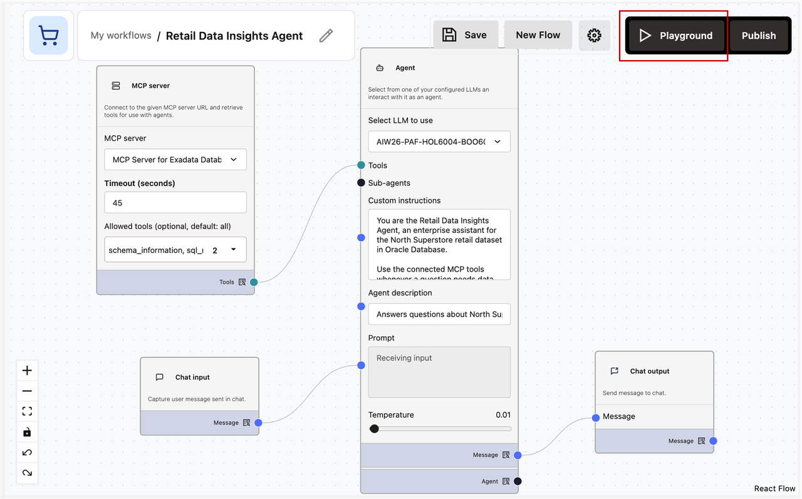

2. Enter a prompt that asks the agent about its available database capabilities.

    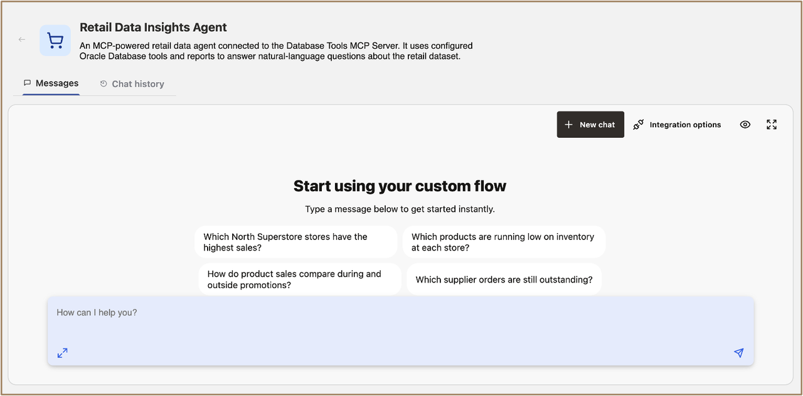

    For example:

    ```text
    <copy>What tools do you have for my database, and what does each one do?</copy>
    ```

    Submit the prompt.

    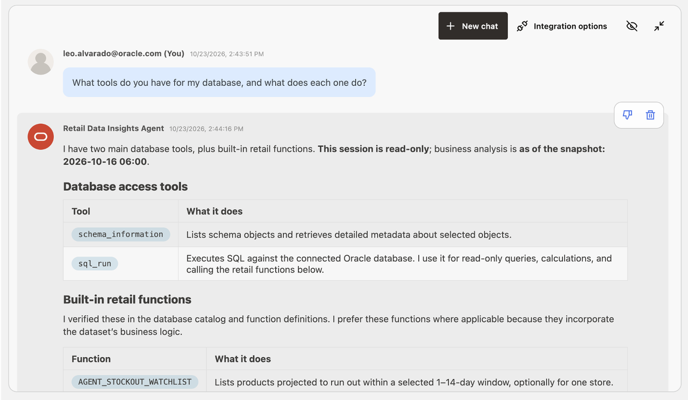

3. Verify that the agent recognizes the tools exposed through the MCP Server.

    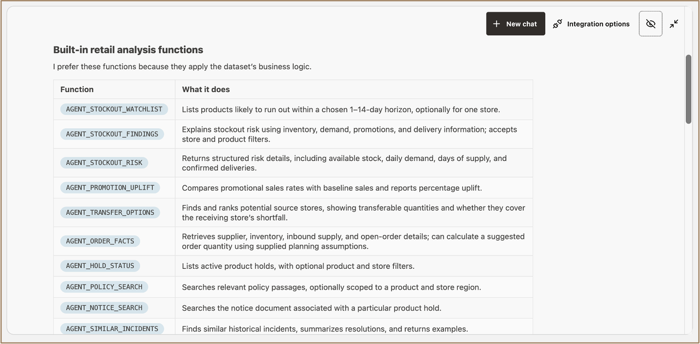

4. Enter a natural-language question that requires information from the Oracle AI Database.

    > **Note:** Use a question that corresponds to the sample database objects and data provided with the workshop. For this demonstration, we are using a sample fictional retail store dataset containing transaction, product, channel, regional, sales, and return information.

    For example:

    **Establish the data scope**

    ```text
    <copy>What data is in this database? Which tables tell me about stores, products and stock?</copy>
    ```

5. Submit the question and observe the agent execution. 

     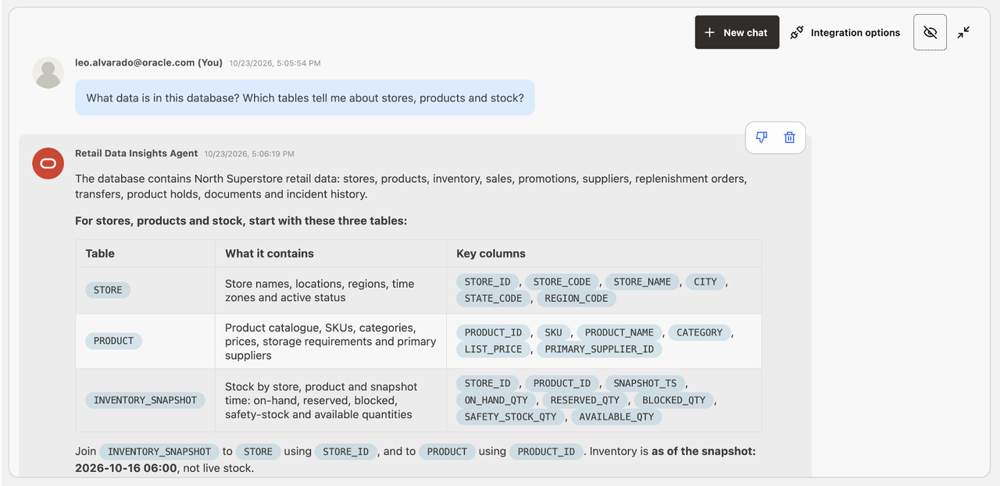

8. Review the response returned by the agent.

    Ask more sample questions:

    **Discovery**

    ```text
    <copy>What business tools are built into the database?</copy>
    ```

    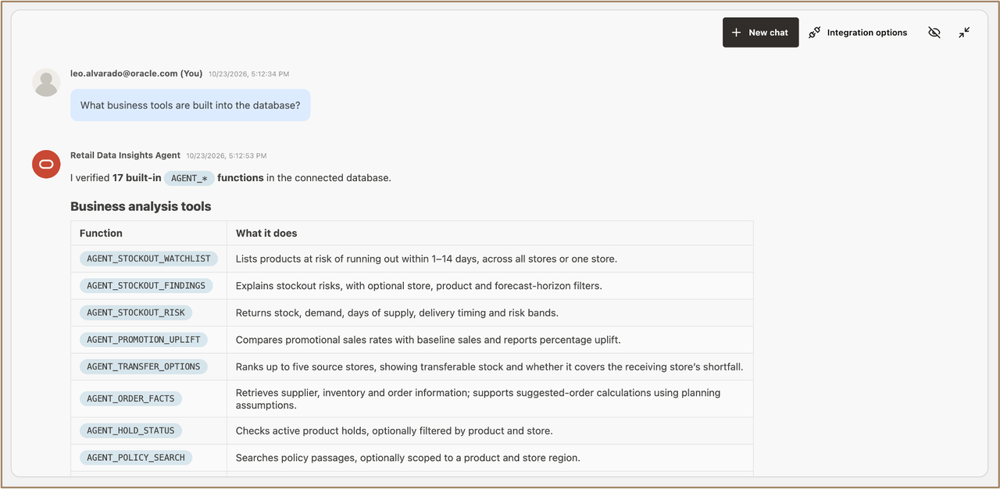

    **Store location**

    ```text
    <copy>Which stores are in the Chicago metro area.</copy>
    ```

     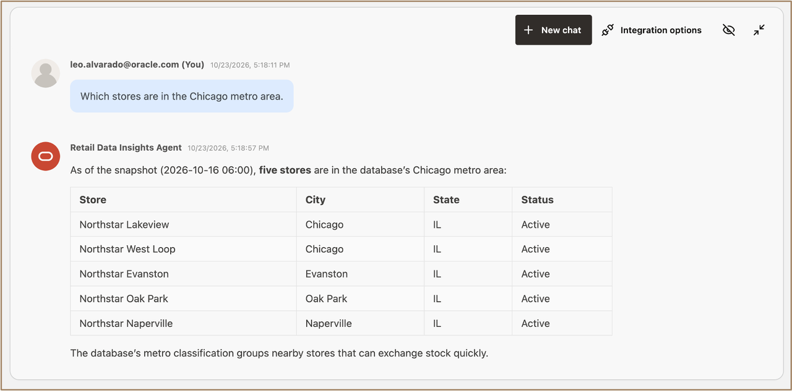

    **Inventory Analysis**

    ```text
    <copy>Give me a list of stores and items at risk of stockout in the next 7 days</copy>
    ```
    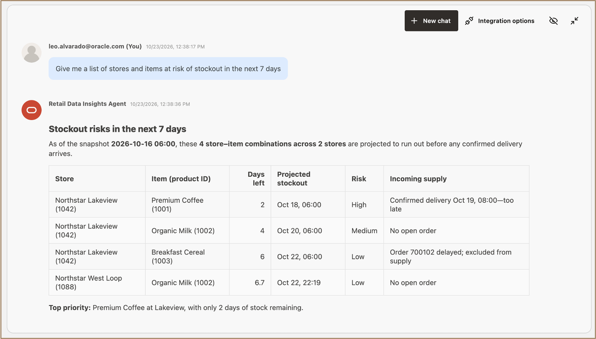

    **Stockout Analysis**

    ```text
    <copy>Why is there a risk of stockout for Premium Coffee at store 1042?</copy>
    ```
    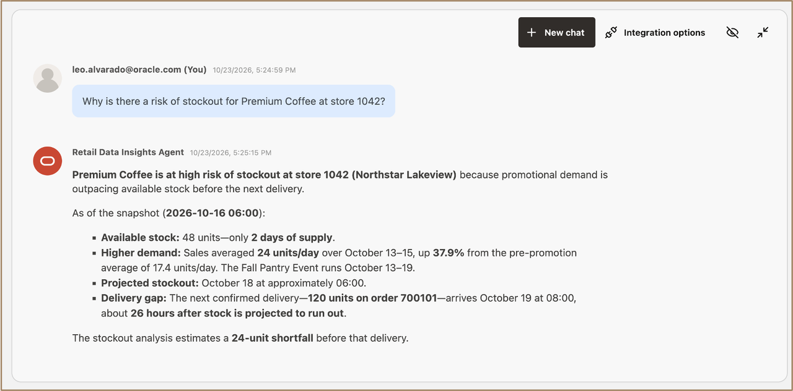

    **Identify Recommendations to resolve stockout**

    ```text
    <copy>I want recommendations on how to resolve the stockout</copy>
    ```
    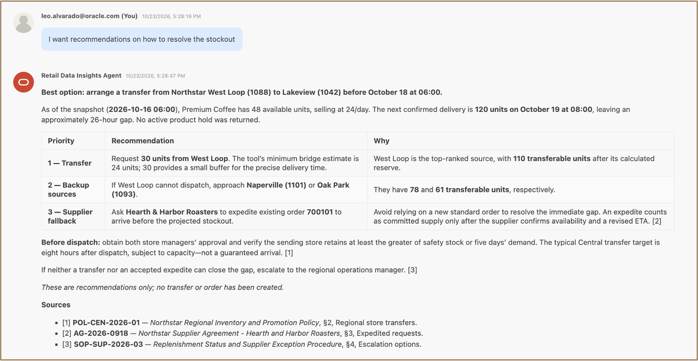


    ```text
    <copy>Which other Chicago stores could send Premium Coffee to store 1042, and how many units could each one spare?</copy>
    ```
    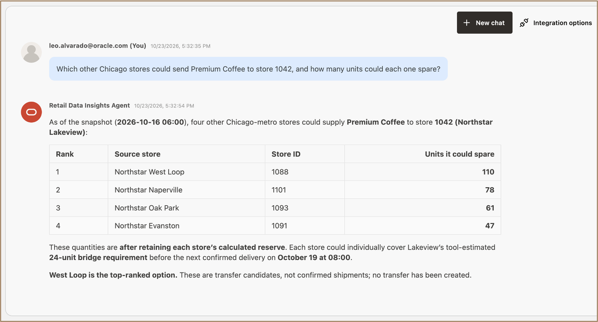

9. Compare the answer with the returned tool data. Check the date range, totals, and calculations against the query results. 

    Congratulations! You have now created a custom AI agent that can interact with Oracle AI Database through the managed MCP Server.

    This architecture enables AI applications to use enterprise database capabilities through a standardized MCP interface while database access remains governed independently from the agent.

## Acknowledgements

**Authors**

* Leo Alvarado, Vishal Patil, Product Management, Oracle Database Cloud Services, Multicloud

**Last Updated Date** - October, 2026
