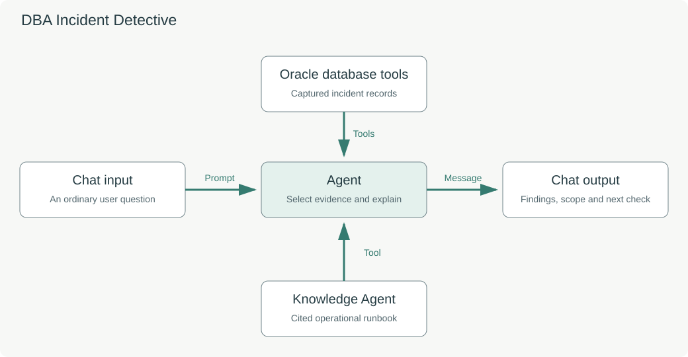

# DBA Incident Detective: Why Is Everyone Waiting?

## Introduction

It is 9:05 and users report that their requests are stuck. The database is running. Someone suggests restarting it. You need to establish what the waiting requests have in common before deciding what to do.

In this lab, you will configure a DBA assistant that combines database evidence with an operational runbook. You will investigate a real blocking incident captured from an isolated training database, identify the affected sessions, and verify the recommended next checks against the runbook.

The instructor has already released the blocking transaction and rolled back the training changes. You are investigating a **captured incident**, not a current outage. The capture makes the exercise repeatable for everyone.

Estimated Time: 20 minutes

### Objectives

In this lab, you will:

- Configure a five-component flow with database tools and a Knowledge Agent.
- Identify a blocking session from observed database evidence.
- Connect a recommendation to a cited runbook section.
- Distinguish captured evidence from current database health.
- Customize the response into an on-call handover.

### Prerequisites

- You are signed in to the instructor-provided Agent Factory environment with an account that can create custom flows.
- You have completed the introductory Agent Builder exercise.
- **DBA Incident Detective** is available in **My Custom Flows** as a supplied example.
- Your account has the **DBA Incident Lab** database connection, the **DBA Incident Runbook** Knowledge Agent, and the workshop generative model.

The instructor prepares the database connection, incident and document ingestion before the exercise. If a required item is missing, ask the instructor to check your account before continuing.

## Task 1: Make your own investigation flow

1. Open **My Custom Flows**. Search for **DBA Incident Detective** and press Enter.

2. On the supplied example, select **Clone**. Open the new **DBA Incident Detective - Copy** using **Edit**.

3. Use the pencil beside the flow name to rename your copy **My DBA Incident Detective**. Add your initials if you use a shared account. Save the name change.

4. Follow the flow on the canvas. There are five components:

    | Component | Purpose |
    | --- | --- |
    | Chat input | Accepts the support question. |
    | Oracle database tools | Retrieves the captured incident records. |
    | Knowledge Agent | Retrieves the relevant runbook procedure. |
    | Agent | Uses both sources to explain the evidence and next checks. |
    | Chat output | Returns the investigation result. |

    The Chat input connects to the Agent's **Prompt**. Both tool components connect to the Agent's **Tools**. The Agent's **Message** connects to the Chat output's **Message**.

    

## Task 2: Connect your evidence and runbook

1. Select **Oracle database tools**. In **Database**, select **DBA Incident Lab** from your own available connections. Keep **Read only** enabled. Leave **SQL root workspace** empty.

    Re-select the connection even if the copied flow already displays a value. A copied flow can retain the original owner's connection identifier.

2. Select **Knowledge Agent**. In **Select Knowledge agent to use**, choose **DBA Incident Runbook**. Its **Tool** output is connected to the Agent; leave its Prompt field empty.

3. Select **Agent**. In **Select LLM to use**, select the model supplied by the instructor, such as **AIW26-PAF-HOL6004-BOO6096**. Leave its Prompt field empty because Chat input supplies the question.

4. Review **Custom instructions**. The supplied instructions require the agent to query the available incident views, retrieve the relevant runbook sections, state the capture time, and separate observations from recommendations. They do not contain the answer's session identifiers.

    If you need to restore them, copy the complete contents of [Agent instructions](files/agent-instructions.txt) into **Custom instructions**.

5. Open **Agent Settings** using the gear beside **New Flow**. Select **Memory**, clear **Enable memory**, and save the settings. Save the flow. Previous investigations must not be treated as evidence for a new incident.

## Task 3: Find what held up the requests

1. Open **Playground** and ask:

    ```text
    <copy>People say the application is stuck. What is happening?</copy>
    ```

2. Read the assessment and find the case identifier and capture time. The answer should identify the evidence as a **captured lab incident**.

3. Ask:

    ```text
    <copy>What is holding everyone up, and who is affected?</copy>
    ```

4. Inspect the returned database evidence in the execution details when available. Find the loader and the two waiting requests. Compare the instance and session identifiers in the answer with the returned rows.

    | Check | Expected relationship |
    | --- | --- |
    | `batch-loader` | An inactive session with an open transaction. |
    | `api-request-1` and `api-request-2` | Two requests waiting on row-lock contention. |
    | Blocking identifiers | Both waiting requests point to the loader in the same captured instance. |
    | Scope | Three tagged training sessions; the incident has already been released. |

    Session numbers can change if the instructor regenerates the capture. Verify the relationships, rather than memorizing a number. The captured wait duration is not the total duration of the incident.

5. Explain the discovery to a partner: **How can an inactive session hold up active work?** Use the open-transaction and blocking evidence to support your answer.

## Task 4: Check the procedure and evidence limits

1. Ask:

    ```text
    <copy>What should I check before trying to fix it?</copy>
    ```

2. Find the runbook reference in the answer. Open a document citation if the response provides one. You can also open the supplied [Blocking Investigation Runbook](files/dba-incident-runbook.pdf) and compare the answer with **RB-04: Check before intervention**.

    The next checks include obtaining current evidence, confirming session identity, identifying the transaction owner, and understanding interruption or rollback impact. A runbook citation supports the procedure; the database records support the observed incident.

3. Ask:

    ```text
    <copy>Is the database healthy right now?</copy>
    ```

4. Verify that the answer acknowledges the evidence gap. A past incident capture cannot establish current health. The agent should not invent CPU readings or claim the application is available.

## Task 5: Create a useful handover

1. Return to the builder and append the following to the Agent's **Custom instructions**:

    ```text
    <copy>Format your answer as an on-call handover with five short bullets: assessment; observed blocker and affected work; evidence time and scope; next check with its runbook section; limitations. Keep it under 150 words.</copy>
    ```

2. Click **Save**, return to **Playground**, and ask:

    ```text
    <copy>Give me a short handover for the next DBA.</copy>
    ```

3. Confirm that the shorter answer still includes the capture time, affected work, a runbook reference and the current-health limitation. Save your flow.

4. Check your result:

    - Your own flow uses your available database connection and the supplied runbook.
    - You can identify the blocker and both waiting requests from the evidence.
    - You can explain which source supports the finding and which supports the next step.
    - You have a saved handover response that does not claim a live diagnosis or a completed repair.

## Learn More

For production use, replace the single captured case with authorized database selection and fresh, scoped evidence. Version the runbooks and verify their applicability to the database release. Any corrective operation needs a separate workflow with current identity and impact checks.

- [Oracle AI Database V$SESSION reference](https://docs.oracle.com/en/database/oracle/oracle-database/26/refrn/V-SESSION.html)
- [Knowledge Agents in Oracle Private Agent Factory](https://docs.oracle.com/en/database/oracle/agent-factory/26.7/paias/create-knowledge-agent.html)

## Acknowledgements

- **Author** - Kumar G. Varun, Oracle Database Applied AI
- **Last Updated By/Date** - Kumar G. Varun, October 2026
