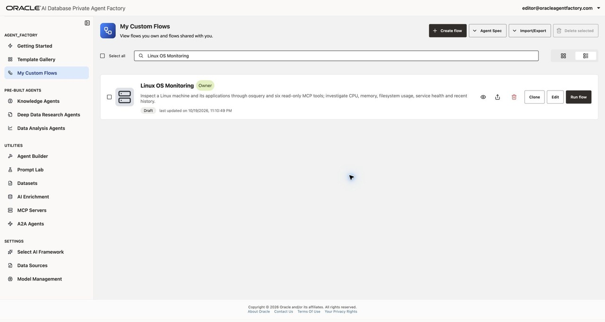
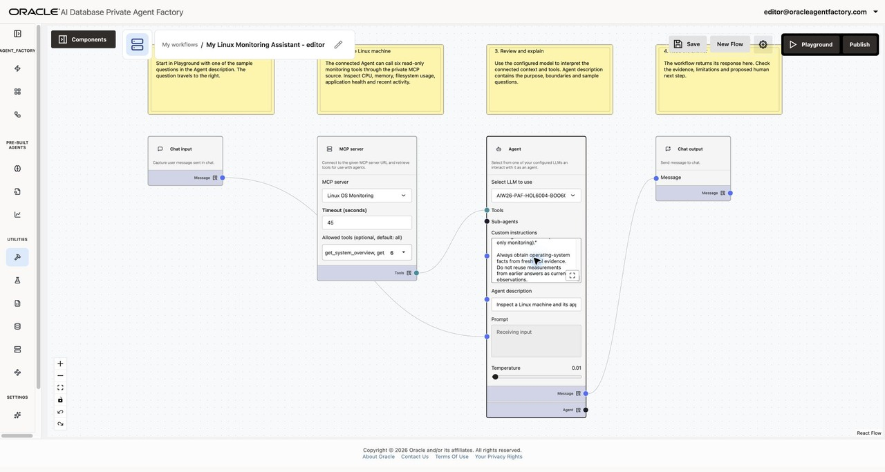
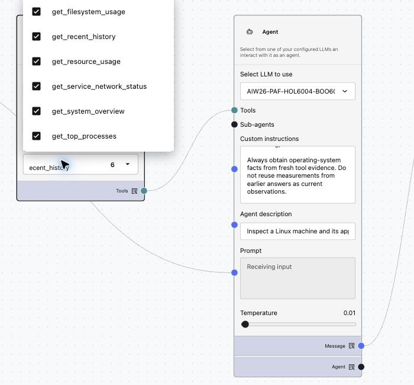
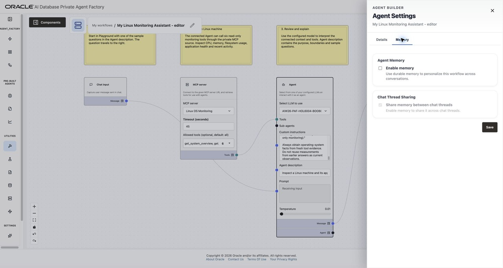
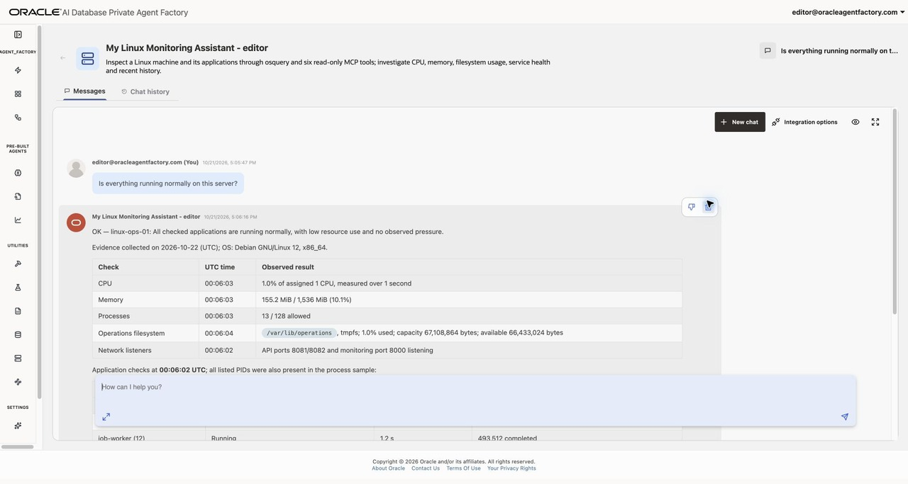
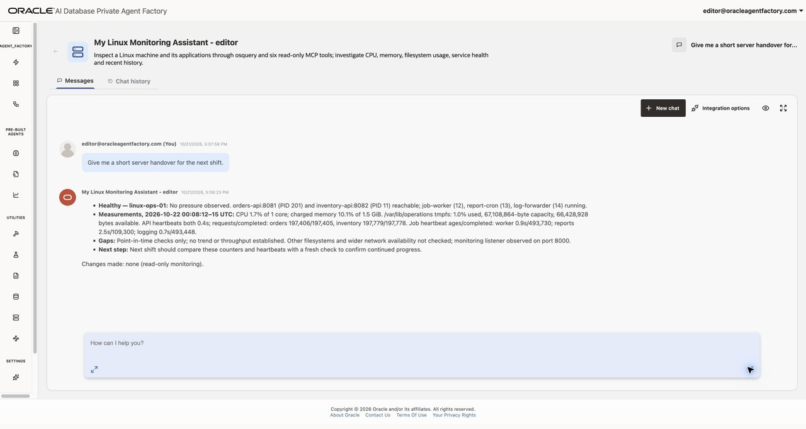

# Linux Monitoring: Is the Server OK?

## Introduction

You are almost out the door when a colleague asks, "Before you go, is everything running normally?" A useful answer needs more than a CPU percentage. You need to check resources, applications and background work, then explain what you actually observed.

In this lab, you will configure a Linux monitoring assistant, inspect live tool results, and turn its answer into a short shift-handover note. The instructor supplies the monitored machine and its MCP connection. Your agent has six read-only monitoring tools.

Estimated Time: 15 minutes

> **Optional AIW activity:** Start after Lab 3. Choose this 15-minute extension if you want to explore operations monitoring. You can complete it independently of Lab 4 and the DBA Incident Detective lab. Your instructor must provide the monitoring flow and MCP connection listed below.

### Objectives

In this lab, you will:

- Configure an Agent to use a bounded set of MCP tools.
- Compare server resource measurements with application checks.
- Verify observation times and the scope of an answer.
- Customize the response for an operations handover.

### Prerequisites

- You are signed in to the instructor-provided Agent Factory environment with an account that can create custom flows.
- You have completed Lab 3, or an introductory Agent Builder exercise covering components, tools and Playground.
- **Linux OS Monitoring** is available in **My Custom Flows**.
- The **Linux OS Monitoring** MCP connection and workshop generative model are available to your account.

The monitored machine and MCP server are prepared before the lab. In the AIW HOL instance, **editor@oracleagentfactory.com** owns the **Linux OS Monitoring** connection and shares it with the **aiw26-all-users** lab group with **Can view** access. Use this existing connection in your cloned flow. If it is missing or unavailable, ask the instructor to check your group access before continuing.

## Task 1: Make your own monitoring assistant

1. Open **My Custom Flows**. Search for **Linux OS Monitoring** and press Enter.

    

2. Select **Clone** on the supplied example. Open **Linux OS Monitoring - Copy** using **Edit**.

3. Use the pencil beside the flow name to rename your copy **My Linux Monitoring Assistant**. Add your initials if you use a shared account. Save the name change.

4. Follow the four components on the canvas:

    | Component | Purpose |
    | --- | --- |
    | Chat input | Accepts the operator's question. |
    | MCP server | Provides six read-only monitoring tools. |
    | Agent | Chooses checks and explains their results. |
    | Chat output | Returns the answer to the operator. |

    Chat input connects to the Agent's **Prompt**. The MCP server connects to the Agent's **Tools**. The Agent's **Message** connects to the Chat output's **Message**.

    

    The screenshots use a working copy named **My Linux Monitoring Assistant - editor**. Use your own name or suffix for your copy.

## Task 2: Configure the tool connection

1. Select the **MCP server** component and choose the supplied **Linux OS Monitoring** connection.

2. In **Allowed tools**, select these six tools:

    | Tool | What it checks |
    | --- | --- |
    | `get_system_overview` | Machine identity and overall resource observations. |
    | `get_resource_usage` | CPU and memory measurements. |
    | `get_top_processes` | Processes contributing to observed resource use. |
    | `get_filesystem_usage` | The configured operations filesystem. |
    | `get_service_network_status` | The configured applications and background jobs. |
    | `get_recent_history` | Available recent monitoring samples. |

    An empty allowed-tool selection can enable every tool exposed by a server. Select the intended six explicitly.

    

3. Select **Agent**. In **Select LLM to use**, choose the workshop model, such as **AIW26-PAF-HOL6004-BOO6096**. Leave its Prompt field empty because Chat input supplies the question.

4. Replace **Custom instructions** with the complete contents of [Agent instructions](files/agent-instructions.txt). Review the guidance: a general health question requires both system and application checks. An application question also examines processes. A question about change over time requires recorded history.

5. Open **Agent Settings** using the gear beside **New Flow**. Select **Memory**, clear **Enable memory**, and save the settings. Save the flow. The agent can inspect measurements and recommend a follow-up; these tools do not provide a shell or restart capability.

    

## Task 3: Ask the question an operator would ask

1. Open **Playground** and ask:

    ```text
    <copy>Is everything running normally on this server?</copy>
    ```

2. Find the machine name, observation time, measured resources and checked applications in the response. Inspect a returned tool result in the execution details when available and compare it with the answer.

    A tool name mentioned in prose does not establish that the tool succeeded. If a tool failed, the answer should explain the gap.

    

    The example shows the start of the answer. Scroll within the message area to review the application checks and coverage limits. Live readings and timestamps will differ.

3. Ask:

    ```text
    <copy>Which applications are running, and is anything struggling?</copy>
    ```

4. Look for evidence about the configured HTTP applications and background jobs. Compare application checks with process information. A running process and a successful application check provide different evidence.

5. Discuss: **Does low CPU usage prove the application is healthy?** Point to an application check in the answer that helps you make a better assessment.

    Live values change. A healthy result is a successful outcome for this exercise; you do not need to find a fault. The supplied server is shared, so leave its applications and configuration unchanged.

## Task 4: Improve the handover

1. Return to the builder and append this text to the Agent's **Custom instructions**:

    ```text
    <copy>For a shift handover, use four short bullets and no table: overall assessment; the most relevant measurements with observation time; checks not performed or evidence gaps; one useful next step. This concise format overrides the default evidence table. Keep it under 150 words, followed by your read-only changes statement.</copy>
    ```

2. Click **Save**, return to **Playground**, and ask:

    ```text
    <copy>Give me a short server handover for the next shift.</copy>
    ```

3. Confirm that the concise answer retains observation times and evidence gaps. The agent should obtain fresh measurements rather than simply repeat the previous answer.

    

4. Save your flow and check your result:

    - Your flow explicitly selects the six monitoring tools.
    - You can identify a successful tool result and its observation time.
    - Your answer distinguishes measured server resources from checked application health.
    - Your handover retains coverage limits and does not claim that a repair was performed.

## Task 5: Optional challenge — ask about change over time

1. If you have time, ask:

    ```text
    <copy>Has the server been getting busier over the last five minutes?</copy>
    ```

2. Compare the returned sample times. The agent should state the period actually covered and identify gaps. A single reading does not establish a trend, and a cumulative counter does not establish a rate without another observation.

## Learn More

The demonstration checks one configured machine, five applications and a small operations filesystem. Its filesystem results do not cover every disk on the host. Production use would add authorized machine selection, retained telemetry and service-specific health criteria. Any remediation would be a separate workflow.

- [Oracle Private Agent Factory documentation](https://docs.oracle.com/en/database/oracle/agent-factory/26.7/paias/)

## Acknowledgements

- **Author** - Kumar G. Varun, Oracle Database Applied AI
- **Last Updated By/Date** - Kumar G. Varun, October 21, 2026
