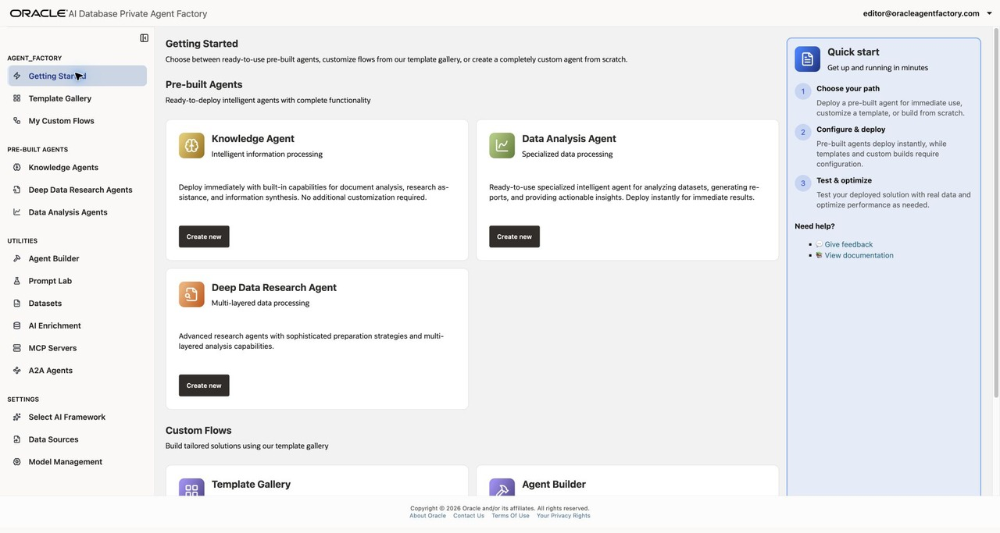
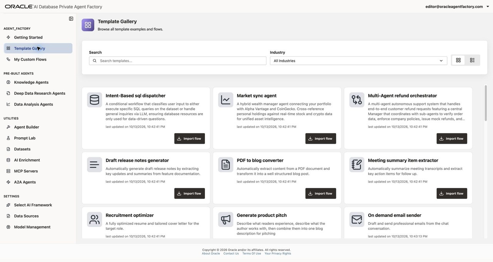
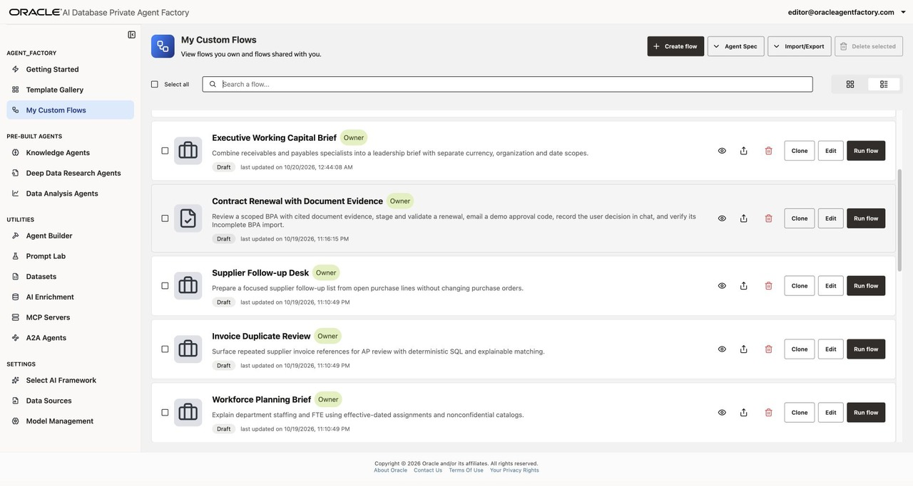
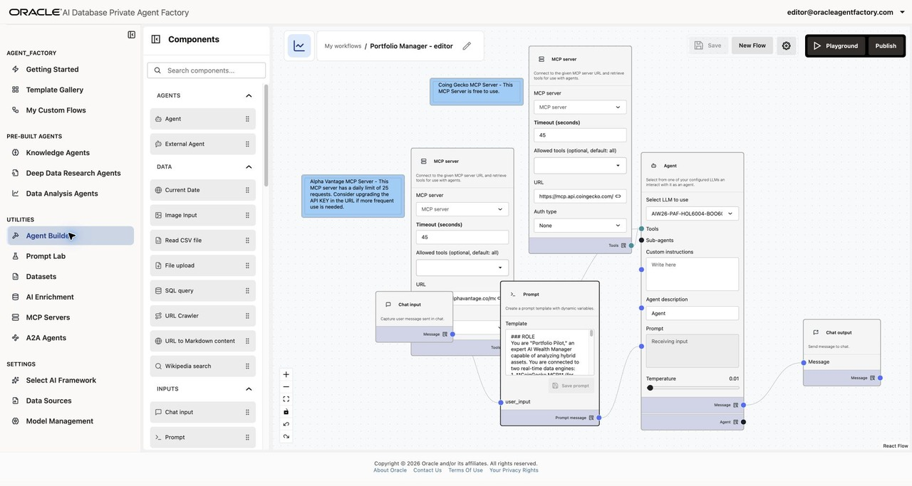
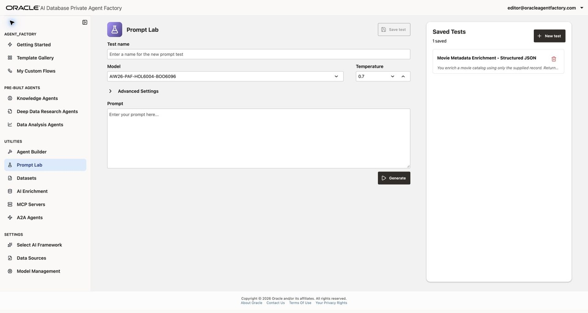
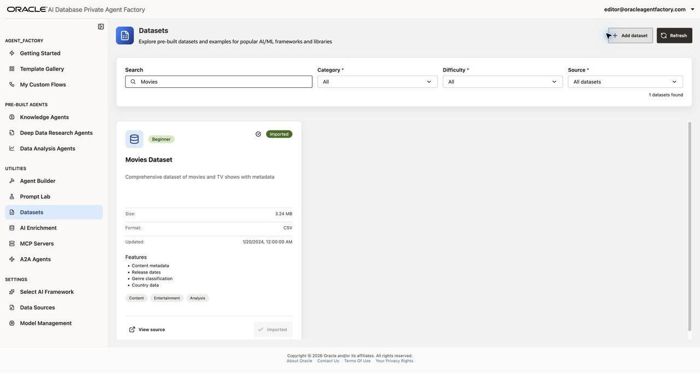
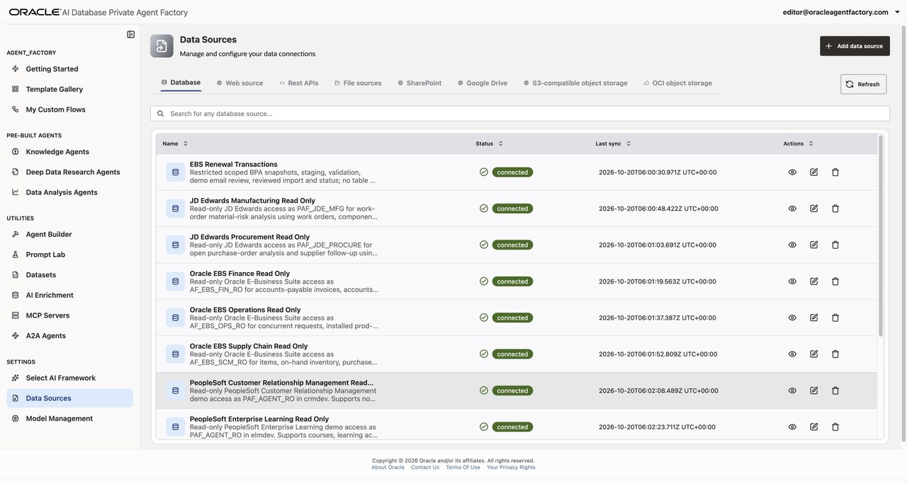
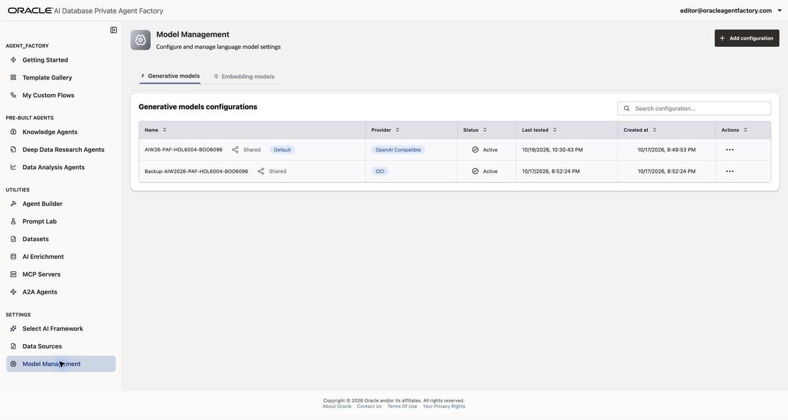

# Overview of Oracle AI Database Private Agent Factory

## Introduction

Oracle AI Database Private Agent Factory (Agent Factory) is a no-code platform for building, testing, and deploying AI agents and workflows. It brings together enterprise data, language models, and tools in a visual application. You can start with a specialized pre-built agent, adapt a reusable template, or design a custom flow with Agent Builder.

In this lab, you will explore the product using the workshop environment provided by your instructor. You will learn where to find the features used in the next labs and how data sources, models, and access controls support an agent.

Estimated Time: 15 minutes

### Objectives

In this lab, you will:

- Explain the purpose of Agent Factory and its three agent-building paths.
- Compare Knowledge, Data Analysis, and Deep Data Research agents.
- Explore the Template Gallery, My Custom Flows, and the visual Agent Builder.
- Locate utilities for prompts, datasets, data enrichment, and external tools and agents.
- Identify the data sources and models available to your workshop account.
- Find the additional agents provided for open-ended exploration.

### Prerequisites

- Access to the workshop's existing Agent Factory environment.
- The application URL and sign-in details supplied by your instructor.
- A learner account with permission to view the workshop features.

> **Note:** Use your assigned workshop **Editor** account. The screenshots show `editor@oracleagentfactory.com`, a sample learner account; your sign-in name will differ. Editors can build and test agents using the supplied resources. Administrator pages such as User Management, Resource Management, and Application Settings are not part of this tour. This tour uses page navigation and inspection; agent creation begins in Lab 2.

## Task 1: Explore Getting Started

1. Open the Agent Factory URL supplied by your instructor and sign in with your workshop account.

2. Select **Getting Started** in the left navigation menu.

    

3. Review the three ways to build an agent. Scroll down to see the **Custom Flows** cards.

    | Path | Starting point | Typical use |
    | --- | --- | --- |
    | Pre-built agents | A specialized agent and your data | Answer document questions, analyze structured data, or research file content. |
    | Template Gallery | A reusable workflow | Adapt an existing pattern to your use case. |
    | Agent Builder | A visual canvas and reusable components | Design the steps, tools, and logic of your own workflow. |

4. Locate the four navigation groups: **AGENT_FACTORY**, **PRE-BUILT AGENTS**, **UTILITIES**, and **SETTINGS**. The first two groups help you find agents and flows. Utilities support building and testing. Your Editor account's Settings group contains **Select AI Framework**, **Data Sources**, and **Model Management**.

5. Consider a document assistant: its data source supplies the reference material, a model interprets the question, and the agent retrieves relevant content to produce an answer. A custom workflow can add tools and routing when the task requires more steps.

## Task 2: Compare the pre-built agents

1. Under **PRE-BUILT AGENTS**, select **Knowledge Agents**. Locate **Create agent** and the agent search field. Your available agents appear here.

    A Knowledge Agent uses retrieval-augmented generation (RAG) to answer questions from selected knowledge sources. Its answers include citations so you can inspect the supporting content. In Lab 2, you will create one using a PDF.

2. Select **Data Analysis Agents**. This is the starting point for agents that answer questions about database tables and views. In Lab 2, you will use the Oracle EBS product inventory view and examine generated SQL, tables, and visualizations.

3. Select **Deep Data Research Agents**. This agent type prepares a searchable knowledge base from file data sources and answers research questions with citations to retrieved documents.

4. Compare the agent types against these example questions.

    | Example question | Starting agent |
    | --- | --- |
    | What does this policy document say about eligibility? | Knowledge Agent |
    | How many titles were released each year in this dataset? | Data Analysis Agent |
    | What findings in this collection of research files address my question? | Deep Data Research Agent |

    Some agents may already be provided, including **Oracle EBS Payables Analysis** under Data Analysis Agents. You will create your own Knowledge and Data Analysis agents in the next lab. Existing agents are additional examples, not prerequisites for completing the lab.

## Task 3: Explore templates and saved flows

1. Select **Template Gallery**. Review the template cards, search field, and **Industry** filter.

    

2. Locate **Market sync agent** and read its description. It combines portfolio questions with stock and cryptocurrency data tools. Lab 3 uses this template to introduce tool-connected custom flows. Leave the template in the gallery for now.

3. Review another template and identify its business task. Notice that **Import flow** is the entry point for adapting a template in Agent Builder.

4. Select **My Custom Flows**. This page lists flows you own and flows shared with you. Locate **Create flow**, **Agent Spec**, and **Import/Export**. These controls provide entry points for new flows and workflow exchange. Your workshop account already contains additional example agents. You can explore them at any time; the optional activity below explains how.

    Scroll within the list to explore more examples.

    

## Task 4: Tour the visual Agent Builder

1. Select **Agent Builder** under **UTILITIES**. Locate the **Components** panel and the canvas. If an existing saved flow opens, click **New Flow** to start an empty canvas for this tour. If the panel is collapsed, select **Components** to open it. Allow the component list to finish loading before using its search field.

    

2. Review the component groups. Components provide different parts of a workflow:

    | Group | Examples | Purpose |
    | --- | --- | --- |
    | Agents | Agent, External Agent | Reason about a task or delegate work. |
    | Data | SQL query, File upload, URL Crawler | Bring data into a flow. |
    | Inputs | Chat input, Prompt | Accept a request and provide instructions. |
    | Language Model | LLM, Vision-language model (VLM) | Use text or image understanding. |
    | Outputs | Chat output | Return a result to the user. |
    | Processing | Condition, Parser, Text combiner | Route requests and transform intermediate results. |
    | Tools | Knowledge Agent, Data Analysis Agent, MCP server, REST API tools | Reuse specialized agents and callable tools. |

3. Use **Search components** to find **Prompt**, then clear the search. Inspect the component list without adding nodes to the canvas.

4. Locate **Save As**, **Playground**, and **Publish**. **Playground** is where you test a flow; **Publish** makes a completed flow available for use. Controls can be disabled on an empty canvas. Lab 3 walks through the components, testing, and publishing of an imported flow.

## Task 5: Review the supporting utilities

1. Select **Prompt Lab**. Locate the model selector, temperature, prompt field, **Generate**, and **Saved Tests**. This page lets you experiment with a prompt and inspect model responses before using the prompt in a workflow.

    

2. Select **Datasets**. Review the sample dataset cards, filters, and **Import Dataset** buttons. Each card describes its content and format. Lab 2 uses an existing database view and does not require a dataset import.

    

3. Select **AI Enrichment**. This utility uses annotations to make database sources more understandable for AI. When database objects are available, you can select an object to inspect its details.

4. Select **MCP Servers**. Model Context Protocol (MCP) servers expose tools that agents can call. This page manages the server connections used by agents and flows. An empty list means no servers have been added for your account.

5. Select **A2A Agents**. Agent2Agent (A2A) supports collaboration with other agents. Review the **Agent Factory agents** and **External agents** tabs. The first lets you review which published agents are enabled for A2A clients; the second manages trusted remote agents.

## Task 6: Locate data, models, and access controls

Review these pages as a product tour. Use the workshop's supplied resources in the later labs.

1. Select **Data Sources** under **SETTINGS**. Review the source tabs, including **Database**, **Web source**, **Rest APIs**, and **File sources**. Additional tabs provide connectors for SharePoint, Google Drive, and object storage. Keep the search field empty for this overview. The **Database** tab lists the supplied EBS, JD Edwards, PeopleSoft, and sample-data connections. Scroll inside the source list to see the remaining rows.

    

    To locate the Lab 2 connection, enter `Oracle EBS Operations` in **Search for any database source...**. Lab 2 uses **Oracle EBS Operations Read Only** and its `APPS.XXAF_OPS_PRODUCTS_V` view. Clear the search to return to the full list shown above. A **connected** label alone does not verify that the creation wizard can list or query an object.

2. Select **Model Management**. Review the **Generative models** and **Embedding models** tabs. Generative models produce responses; embedding models represent content as vectors for retrieval. The shared default generative model in this instance is **AIW26-PAF-HOL6004-BOO6096**. **Backup-AIW2026-PAF-HOL6004-BOO6096** is also supplied. Use the default model in the exercises unless your instructor directs you to use the backup.

    

3. Locate **Select AI Framework**, which manages Select AI components for a selected database. The workshop administrator has prepared shared connections and models. Use those existing resources for the exercises.

4. Return to **Getting Started**. Locate **View documentation** in the **Quick start** panel for the product guide.

## Task 7: Explore the additional workshop agents (optional)

These examples are outside the required HOL exercises. You are welcome to run them, inspect their design, clone them, change their prompts and connections, and build your own variations. You do not need to complete them in order, and you can return to them after Labs 2 and 3.

For guided practice after Lab 3, choose an optional activity from the workshop menu when your instructor has prepared its resources:

| Optional activity | Additional time | What you will build |
| --- | --- | --- |
| Optional Lab 5: Linux Monitoring | 15 minutes | A server-health assistant using six MCP tools and a short shift handover. |
| Optional Lab 6: DBA Incident Detective | 20 minutes | An investigation assistant combining captured blocking-session evidence with a runbook Knowledge Agent. |

Choose either activity if time permits. Each works independently of Lab 4 and the other optional activity. The DBA exercise also uses the Knowledge Agent concepts from Lab 2 and requires a database registration for your own account.

1. Open **My Custom Flows**. The sample account includes the following examples; the exact list can vary by assigned account.

    | Agent | What to explore |
    | --- | --- |
    | Executive Working Capital Brief | Combine receivables and payables specialists into a leadership brief. |
    | Supplier Follow-up Desk | Prepare a supplier follow-up list from open purchase lines. |
    | Invoice Duplicate Review | Explain repeated supplier invoice references. |
    | Workforce Planning Brief | Summarize department staffing and FTE. |
    | Sales Commitment Review | Review unshipped sales-order lines and draft a customer update. |
    | IT Operations Triage | Route outage and batch-performance questions to focused assistants. |
    | Field Material Readiness | Compare a fictional dispatch plan with work-order material requirements. |
    | Learning Evidence Review | Review recorded training completion and enrollment evidence. |
    | Business Policy Desk | Answer questions from the supplied handbook with section citations. |
    | Service Case Workload | Summarize CRM case workload by business unit, status, and priority. |
    | Linux OS Monitoring | Inspect CPU, memory, filesystems, and services through MCP tools. |
    | Contract Renewal with Document Evidence | Explore document evidence and a staged contract-renewal workflow. |
    | Invoice Review and Actions | Explore invoice review and the configured invoice-action tools. |

    There are also **AI World 2026 Session Guide** and **AI World 2026 Attendee Guide** examples under **Knowledge Agents**, and **Oracle EBS Payables Analysis** under **Data Analysis Agents**. Open those with **Open agent**. The same habit applies: read the description, ask a focused question, and inspect the evidence behind the answer.

2. Read an agent's description, then click **Run flow**. Some supplied flows are **Draft**; you can test them in the application before publishing. Try `What can you help me with, and what inputs do you need?`, then ask a focused question supported by its data. Review returned records, citations, tool results, and any stated limits.

3. Click **Clone** to make a working copy. The new name ends in **- Copy**. Click **Edit** on that copy, then use the pencil beside its flow name to give it a unique name. Inspect the prompt, selected model, database or file sources, and tool connections. Lab 3 explains how to change a prompt, save, and test it in **Playground**.

4. Change one part of your copy, save it, start a **New chat**, and repeat the same question. Compare the answer with your baseline and the underlying evidence. Try a missing input, a follow-up question, and a question outside the source's scope. Publish your copy when you are satisfied with the result.

5. You can experiment freely with your own flows and the supplied demo data. For the contract-renewal and invoice-action examples, begin with review questions and inspect the tools before testing actions: those flows can send a demo email or change connected demo records. Use the intended demo target and the confirmation steps shown by the agent. A preloaded flow or a successful import does not guarantee that every external service is available.

## Summary

You have explored the main Agent Factory features and identified the pages used to build agents, reuse templates, test prompts, connect data and tools, and manage access.

Before continuing, confirm that you can locate:

- **Knowledge Agents** and **Data Analysis Agents** for Lab 2.
- **Template Gallery**, **Agent Builder**, and **Playground** for Lab 3.
- **Data Sources** and **Model Management** for the resources an agent uses.

You may now **proceed to Lab 2: Create Knowledge Agent (KA) and Data Analysis (DA) Agents**.

## Learn More

- [Introduction to Agent Factory](https://docs.oracle.com/en/database/oracle/agent-factory/26.7/paias/introduction.html)
- [Agent Factory User's Guide](https://docs.oracle.com/en/database/oracle/agent-factory/26.7/paias/)

## Acknowledgements

- **Author** - Kumar G. Varun, Lead PM, Oracle Database Applied AI
- **Last Updated By/Date** - Kumar G. Varun, October 21, 2026
