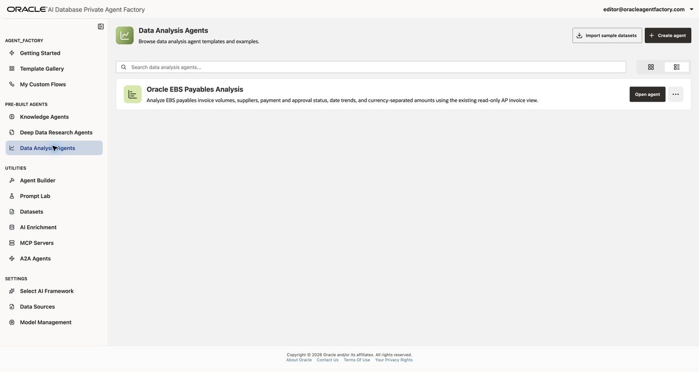
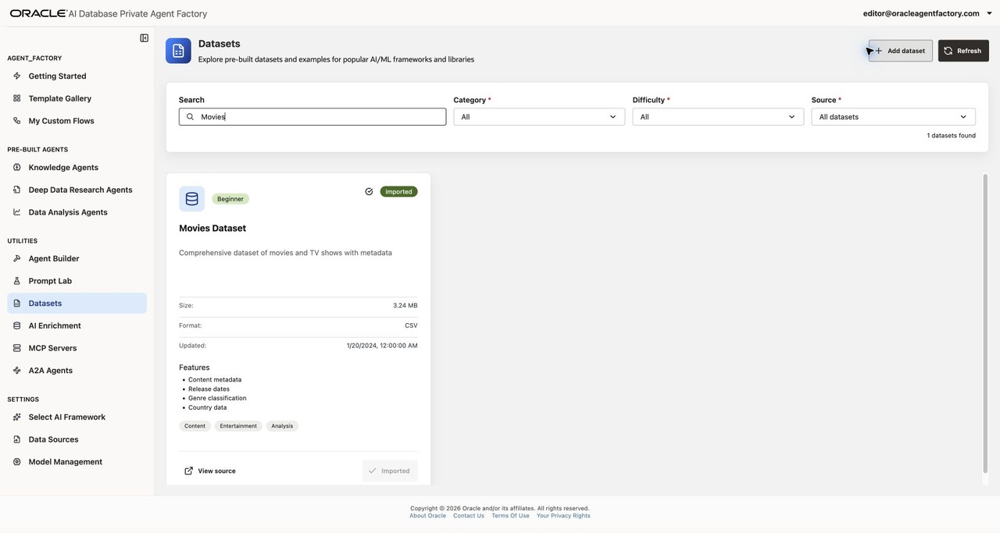

# Create Knowledge and Data Analysis Agents

## Introduction

Oracle AI Database Private Agent Factory provides pre-built agents for common tasks. In this lab, you will create a Data Analysis Agent over a sample movie dataset and a Knowledge Agent over a PDF.

The Data Analysis Agent answers questions about structured data using generated SQL, query results, and natural language explanations. Its initial exploration suggests questions about the selected table. Depending on the question, the response can also include a chart.

The Knowledge Agent uses retrieval-augmented generation (RAG) to answer questions from unstructured content. Citations let you inspect the source passages supporting an answer.

**Estimated time:** 30 minutes.

### Objectives

- Create a Data Analysis Agent using the provided Movies Dataset
- Ask a question and inspect the generated SQL and results
- Create a Knowledge Agent using a PDF and review its answer citations

### Prerequisites

* You have completed the Agent Factory overview lab and are signed in with your assigned **Editor** account
* The workshop environment has the preloaded Movies Dataset, a database source that can query it, and the shared **AIW26-PAF-HOL6004-BOO6096** generative model
* You have a PDF to upload, or can save the documentation page in Task 2 as a PDF

## Task 1: Create and talk to a Data Analysis Agent using the Movies Dataset

1. In the sidebar, select **Data Analysis Agents**.

2. Click **Import sample datasets**.

    

3. On the **Datasets** page, search for **Movies**. The HOL instance already has **Movies Dataset** imported, so the **Imported** button is disabled. Continue without importing another copy. If your assigned instance has not been prepared, ask your instructor to import the dataset before continuing; the workshop's shared dataset source is read-only.

    

4. Return to **Data Analysis Agents** and click **Create agent**.

5. In **Select data sources**, choose **Applied AI Enrichment Lab** from the **Database** list. Search for `AGENT_FACTORY.AAI_DATASETS_MOVIES_DATASET`, select that **TABLE** card, then click **Next**. This is the imported Movies Dataset. A Data Analysis Agent uses one table in this flow.

    The instance also contains **Applied AI Datasets** and an `AAI_DATASETS_RO.MOVIES_DATASET` view. Use the source and **TABLE** named above for this HOL: the shared dataset connection and the view failed the creation checks during the workshop review. In another instance, use the Movies source and object supplied by your instructor. If the wizard reports **Unable to connect to the Database** or publication reports `ORA-00942`, have the instructor check the connection and object access before retrying.

    

6. In **Fill up agent details**, enter an **Agent name** and **Description**. For example:

    * **Agent name:** Movies Data Analysis Agent - editor
    * **Description:** Explore movie titles, release years, genres, and ratings in the Movies Dataset.

    Replace `editor` with your assigned user ID or another unique suffix. **Help description** is optional and can provide instructions or tips for using the agent. Click **Next**.

    

7. Review the agent name and selected table, then click **Publish agent**. Wait for publication to finish.

    

8. On the **Data Analysis Agents** page, find your agent and click **Open agent**. In **Messages**, allow the initial exploration to finish and review the suggested questions. If exploration does not start automatically, click **Execute exploration** when available.

    

9. Select the **Data** tab to inspect the table and its columns, including **TYPE**, **TITLE**, and **RELEASE_YEAR**. Scroll horizontally to see additional columns. The HOL table is `AGENT_FACTORY.AAI_DATASETS_MOVIES_DATASET`; the schema prefix can differ in another environment.

    

10. Return to **Messages** and ask **How many titles are movies and how many are TV shows?** Review the answer, generated SQL, and query results. Answers and available visualizations can vary with the model and question.

    To check the counts independently, open **SQL executor**, enter the following read-only query, and click **Run SQL Query**. Compare the returned counts with the agent's answer. If chat exploration is still running, this check also lets you confirm that the dataset can be queried while your instructor checks chat readiness.

    ```sql
    <copy>
    SELECT TYPE, COUNT(*) AS TITLE_COUNT
    FROM AGENT_FACTORY.AAI_DATASETS_MOVIES_DATASET
    GROUP BY TYPE
    ORDER BY TYPE
    </copy>
    ```

    

11. Continue to Task 2 to create an agent that answers questions from a PDF.

## Task 2: Create and talk to a Knowledge Agent for your own data

1. Choose a PDF for this task. For the example used below, open the [Private Agent Factory 26.7 introduction](https://docs.oracle.com/en/database/oracle/agent-factory/26.7/paias/introduction.html) in Chrome. Select **Print**, choose **Save as PDF** as the destination, and save the file locally.

2. In the sidebar, select **Data Sources** and click **Add data source**. Choose **File Source** for **Source type**. Enter a **Source name** and **Description**, for example:

    * **Source name:** Oracle Private Agent Factory Docs editor
    * **Description:** Introduction to Oracle AI Database Private Agent Factory release 26.7.

    Replace `editor` with a unique suffix containing only letters, numbers, or spaces. **Source name** does not accept punctuation such as hyphens or `@`. Drag the PDF into the upload area or use the file picker. Verify that the filename appears, then click **Add file source** to submit it.

    

3. Wait for the upload panel to show that your file upload is **Completed**. Upload completion alone does not mean ingestion has finished; you will check ingestion status in the agent creation wizard below.

4. In the sidebar, select **Knowledge Agents**, then click **Create agent**.

    

5. In **Select data sources**, choose **File system**. Find your source, such as **Oracle Private Agent Factory Docs editor**, and wait until its **Ingestion status** is **ingested**. **embedding** is an intermediate status, and its row cannot yet be selected. Use the refresh button beside the search field if needed. Then select its checkbox and click **Next**. If processing fails, inspect the source status details and ask your instructor for help before repeating the upload.

    

6. In **Create knowledge base**, enter an **Agent name** and **Description**, for example:

    * **Agent name:** Oracle Private Agent Factory Documentation Agent
    * **Description:** Answer questions about Private Agent Factory using the uploaded introduction.

    Select **AIW26-PAF-HOL6004-BOO6096** in the required **Generative Model** list. The backup model is **Backup-AIW2026-PAF-HOL6004-BOO6096**; use it if directed by your instructor. Model names can differ between environments. **Help description** is optional. Add a unique suffix to your agent name. Click **Next**.

    

7. Review the selected source and agent details, then click **Publish agent**. Wait for publication to finish.

    

8. On the **Knowledge Agents** page, find your agent and click **Open agent**.

    

9. Ask a question supported by your PDF. For the documentation example, ask **What are the different ways to build an agent in Oracle Private Agent Factory?**

10. Open a citation to inspect the supporting passage in your source document. Compare it with the answer, then try a follow-up such as **Which pre-built agents ship with Oracle AI Database Private Agent Factory?** If a short follow-up is classified as outside the agent's scope, restate the product or topic explicitly. If you uploaded a different PDF, use questions appropriate to that document.

    

    If either agent's chat input does not appear, **Send Message** remains disabled, exploration never finishes, or a response remains at **Loading chat**, return to the agent list and reopen the agent once. If the issue persists or the application reports **Couldn't process the server response**, ask your instructor to check the workshop environment before creating another agent. Successful publication and a working **Data** tab do not establish that chat is working.

## Summary

You created a Data Analysis Agent over a sample table and a Knowledge Agent over a PDF. You used natural language to explore structured data and inspected document citations for a grounded answer. You may now **proceed to the next lab** to explore custom flows.

## Learn More

* [Create a Data Analysis Agent](https://docs.oracle.com/en/database/oracle/agent-factory/26.7/paias/create-data-analysis-agent.html)
* [Create a Knowledge Agent](https://docs.oracle.com/en/database/oracle/agent-factory/26.7/paias/create-knowledge-agent.html)
* [File Source](https://docs.oracle.com/en/database/oracle/agent-factory/26.7/paias/file-source.html)

## Acknowledgements

**Authors**

* Database Applied AI Technical Staff
* Allen Hosler, Principal Product Manager, Database Applied AI
* Kumar G. Varun, Lead PM, Oracle Database Applied AI

**Last Updated Date** - October 21, 2026
