# Create Knowledge and Data Analysis Agents

## Introduction

Oracle AI Database Private Agent Factory provides pre-built agents for common tasks. In this lab, you will create a Data Analysis Agent over a small Oracle EBS product inventory view and a Knowledge Agent over a PDF.

The Data Analysis Agent answers questions about structured data using generated SQL, query results, and natural language explanations. Its initial exploration suggests questions about the selected table or view. Depending on the question, the response can also include a chart.

The Knowledge Agent uses retrieval-augmented generation (RAG) to answer questions from unstructured content. Citations let you inspect the source passages supporting an answer.

**Estimated time:** 30 minutes.

### Objectives

- Create a Data Analysis Agent using the Oracle EBS product inventory view
- Ask a question and inspect the generated SQL and results
- Create a Knowledge Agent using a PDF and review its answer citations

### Prerequisites

* You have completed the Agent Factory overview lab and are signed in with your assigned account
* The workshop environment provides **Oracle EBS Operations Read Only**, access to the `APPS.XXAF_OPS_PRODUCTS_V` view, and the shared **AIW26-PAF-HOL6004-BOO6096** generative model
* You have a PDF to upload, or can save the documentation page in Task 2 as a PDF

## Task 1: Create and talk to a Data Analysis Agent using EBS product inventory

1. In the sidebar, select **Data Analysis Agents**, then click **Create agent**. The database view is already available; you do not need to import a sample dataset.

2. In **Select data sources**, choose **Oracle EBS Operations Read Only** from the **Database** list. Wait for the available objects to load. Search for `XXAF_OPS_PRODUCTS`, select the `APPS.XXAF_OPS_PRODUCTS_V` **VIEW** card, then click **Next**. A Data Analysis Agent uses one table or view in this flow.

    If the source or view is missing, ask your instructor to check access. If the wizard reports **Unable to connect to the Database** or publication reports `ORA-00942`, have the instructor check the connection and object access before retrying.

    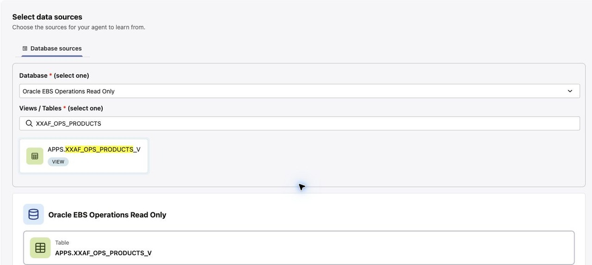

3. In **Fill up agent details**, enter an **Agent name** and **Description**. For example:

    * **Agent name:** EBS Product Inventory Agent
    * **Description:** Analyze Oracle EBS products, installation status, and patch levels from the read-only product inventory view.

    Add a unique suffix to your agent name so you can find it later. **Help description** is optional and can provide instructions or tips for using the agent. Click **Next**.

    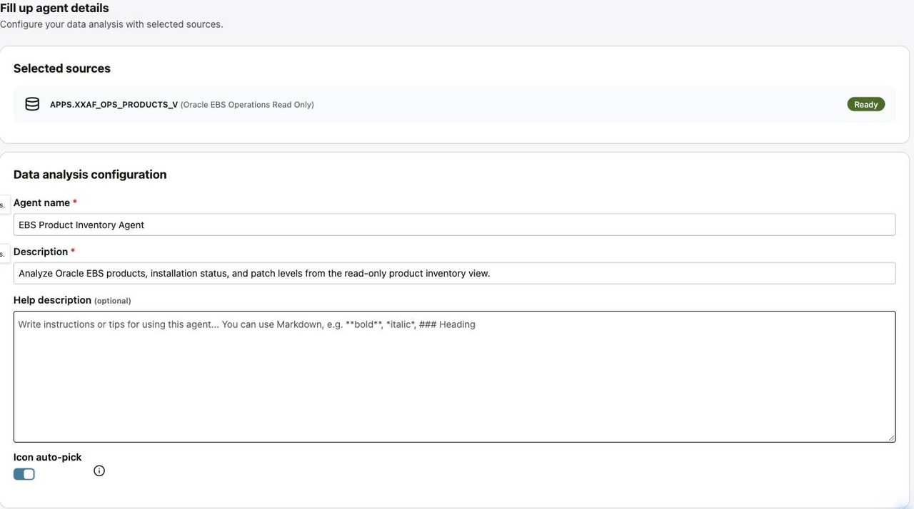

4. Review the agent name and selected view, then click **Publish agent**. Wait for publication to finish.

    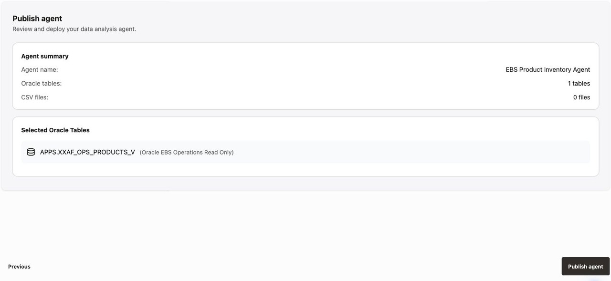

5. On the **Data Analysis Agents** page, find your agent and click **Open agent**. In **Messages**, allow the initial exploration to finish and review the suggested questions and analyses. If exploration does not start automatically, click **Execute exploration** when available.

    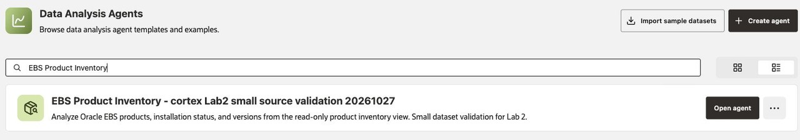

    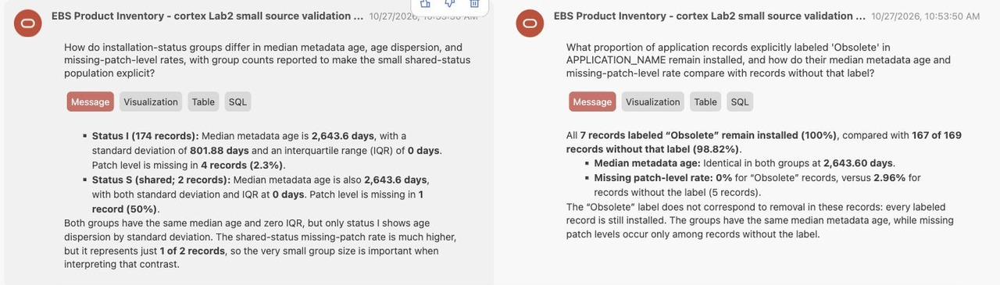

6. Select the **Data** tab to inspect the view. Its six columns are **INSTALLATION_STATUS**, **APPLICATION_NAME**, **APPLICATION_SHORT_NAME**, **LAST_UPDATE_DATE**, **APPLICATION_ID**, and **PATCH_LEVEL**. Scroll horizontally if needed. The prepared workshop sample contains 176 product records.

    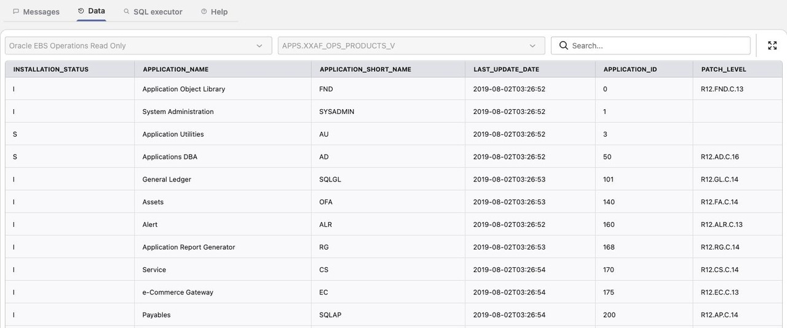

7. Return to **Messages** and ask **How many EBS products are there for each installation status? Show the status codes and counts.** Review the answer, then open **SQL**, **Table**, and **Visualization** to inspect the generated query, results, and chart. Answers and available visualizations can vary with the model and question.

    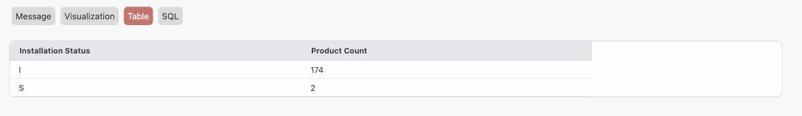

8. To check the counts independently, open **SQL executor**, enter the following read-only query, and click **Run SQL Query**. Compare the returned counts with the agent's answer.

    ```sql
    <copy>
    SELECT INSTALLATION_STATUS, COUNT(*) AS PRODUCT_COUNT
    FROM APPS.XXAF_OPS_PRODUCTS_V
    GROUP BY INSTALLATION_STATUS
    ORDER BY INSTALLATION_STATUS
    </copy>
    ```

    In the prepared workshop sample, status **I** has **174** products and status **S** has **2**, for **176** products in total. If the source data has changed, use the current SQL results to check the agent's answer.

    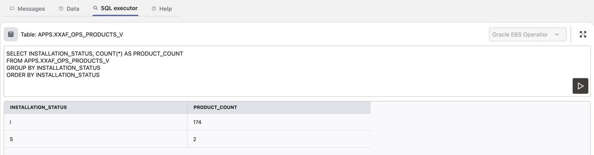

9. Continue to Task 2 to create an agent that answers questions from a PDF.

## Task 2: Create and talk to a Knowledge Agent for your own data

1. Choose a PDF for this task. For the example used below, open the [Private Agent Factory 26.7 introduction](https://docs.oracle.com/en/database/oracle/agent-factory/26.7/paias/introduction.html) in Chrome. Select **Print**, choose **Save as PDF** as the destination, and save the file locally.

2. In the sidebar, select **Data Sources** and click **Add data source**. Choose **File Source** for **Source type**. Enter a **Source name** and **Description**, for example:

    * **Source name:** Oracle Private Agent Factory Docs editor
    * **Description:** Introduction to Oracle AI Database Private Agent Factory release 26.7.

    Replace `editor` with a unique suffix containing only letters, numbers, or spaces. **Source name** does not accept punctuation such as hyphens or `@`. Drag the PDF into the upload area or use the file picker. Verify that the filename appears, then click **Add file source** to submit it.

    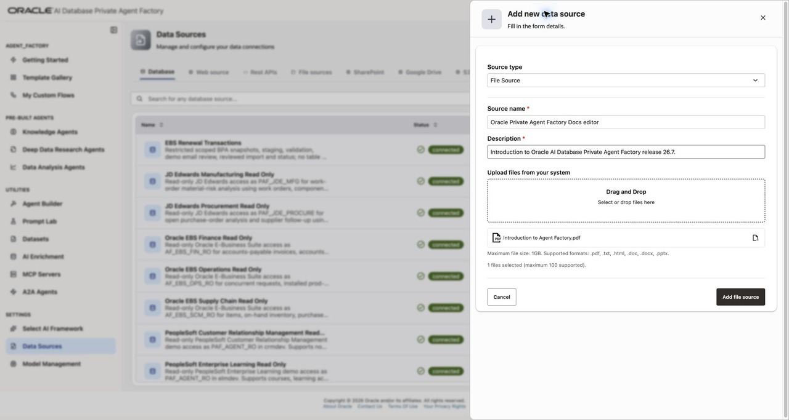

3. Wait for the upload panel to show that your file upload is **Completed**. Upload completion alone does not mean ingestion has finished; you will check ingestion status in the agent creation wizard below.

4. In the sidebar, select **Knowledge Agents**, then click **Create agent**.

    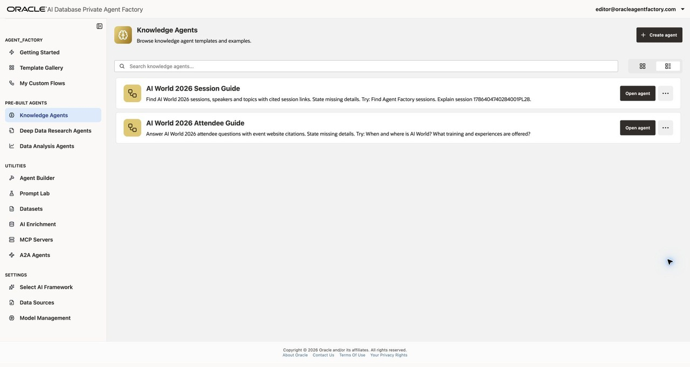

5. In **Select data sources**, choose **File system**. Find your source, such as **Oracle Private Agent Factory Docs editor**, and wait until its **Ingestion status** is **ingested**. **embedding** is an intermediate status, and its row cannot yet be selected. Use the refresh button beside the search field if needed. Then select its checkbox and click **Next**. If processing fails, inspect the source status details and ask your instructor for help before repeating the upload.

    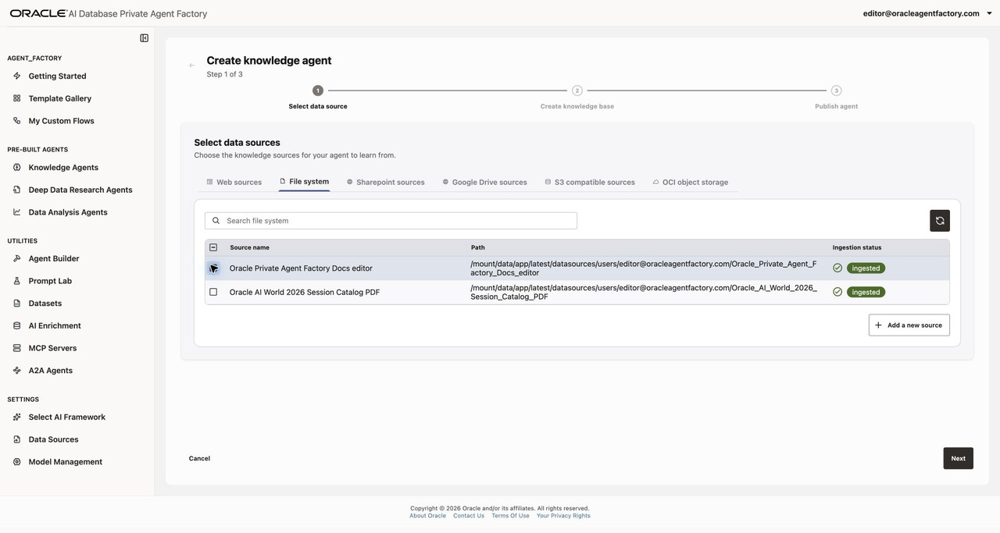

6. In **Create knowledge base**, enter an **Agent name** and **Description**, for example:

    * **Agent name:** Oracle Private Agent Factory Documentation Agent
    * **Description:** Answer questions about Private Agent Factory using the uploaded introduction.

    Select **AIW26-PAF-HOL6004-BOO6096** in the required **Generative Model** list. The backup model is **Backup-AIW2026-PAF-HOL6004-BOO6096**; use it if directed by your instructor. Model names can differ between environments. **Help description** is optional. Add a unique suffix to your agent name. Click **Next**.

    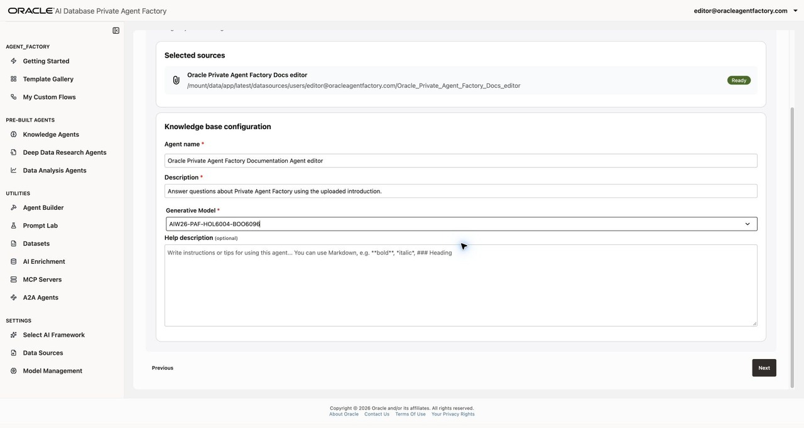

7. Review the selected source and agent details, then click **Publish agent**. Wait for publication to finish.

    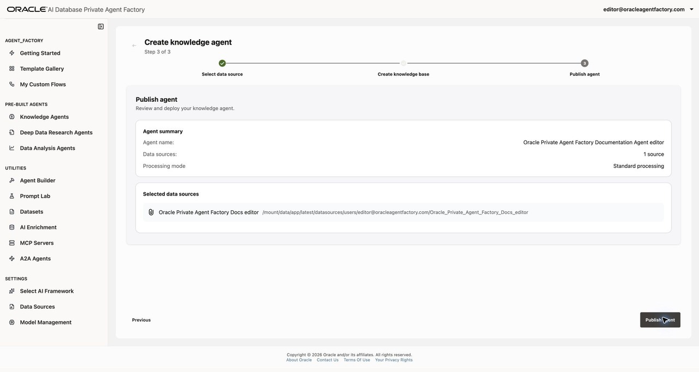

8. On the **Knowledge Agents** page, find your agent and click **Open agent**.

    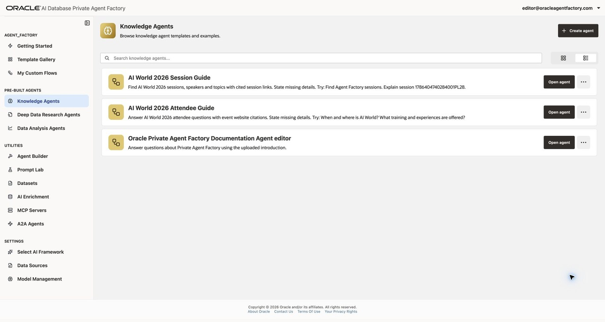

9. Ask a question supported by your PDF. For the documentation example, ask **What are the different ways to build an agent in Oracle Private Agent Factory?**

10. Open a citation to inspect the supporting passage in your source document. Compare it with the answer, then try a follow-up such as **Which pre-built agents ship with Oracle AI Database Private Agent Factory?** If a short follow-up is classified as outside the agent's scope, restate the product or topic explicitly. If you uploaded a different PDF, use questions appropriate to that document.

    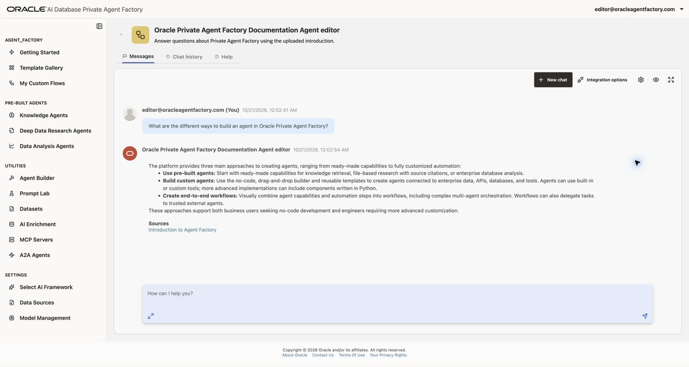

    If either agent's chat input does not appear, **Send Message** remains disabled, exploration never finishes, or a response remains at **Loading chat**, return to the agent list and reopen the agent once. If the issue persists or the application reports **Couldn't process the server response**, ask your instructor to check the workshop environment before creating another agent. Successful publication and a working **Data** tab do not establish that chat is working.

## Summary

You created a Data Analysis Agent over an Oracle EBS product inventory view and a Knowledge Agent over a PDF. You used natural language to explore structured data and inspected document citations for a grounded answer. You may now **proceed to the next lab** to explore custom flows.

## Learn More

* [Create a Data Analysis Agent](https://docs.oracle.com/en/database/oracle/agent-factory/26.7/paias/create-data-analysis-agent.html)
* [Create a Knowledge Agent](https://docs.oracle.com/en/database/oracle/agent-factory/26.7/paias/create-knowledge-agent.html)
* [File Source](https://docs.oracle.com/en/database/oracle/agent-factory/26.7/paias/file-source.html)

## Acknowledgements

**Authors**

* Database Applied AI Technical Staff
* Allen Hosler, Principal Product Manager, Database Applied AI
* Kumar G. Varun, Lead PM, Oracle Database Applied AI

**Last Updated Date** - October 27, 2026
